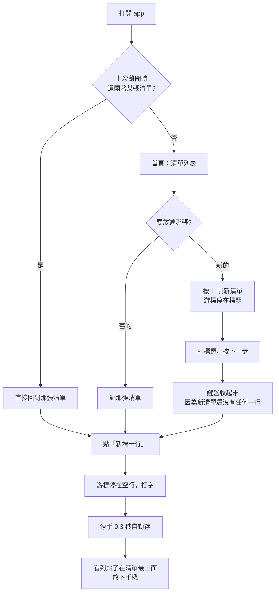
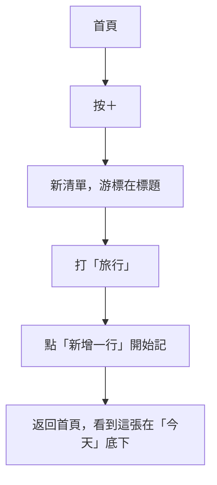
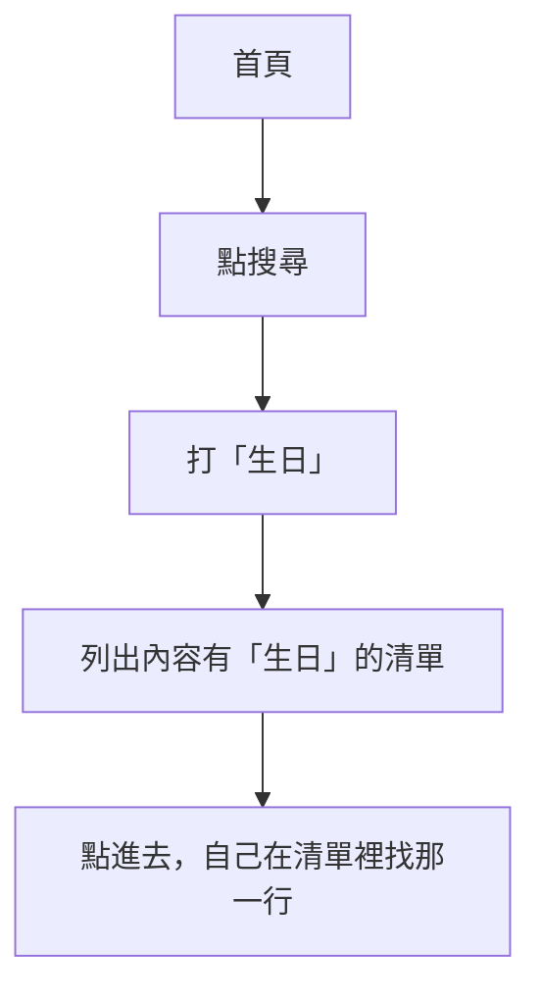
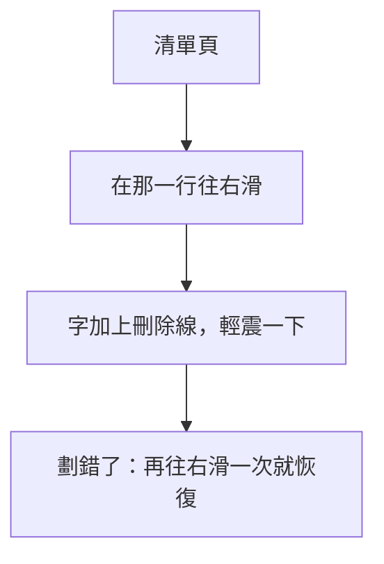
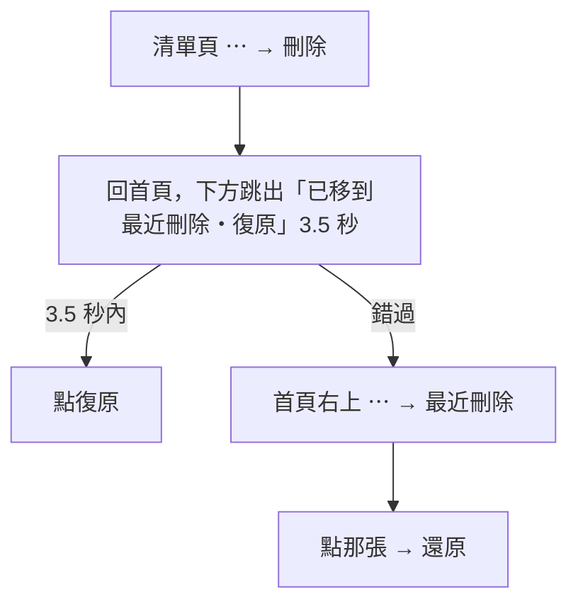

# 茄記｜流程與資訊架構（暫定 v0）

> 狀態：**暫定**。依據 `01-核心動作卡-暫定.md` v0.3（核心動詞＝記，未過閘門 1，情境全為想像）。情境觀察回來、卡片過閘後要回頭重看。
> 茄記已經有可運作的版本，這份是「從程式整理出現在的流程」＋「對照核心動作卡標出要改的地方」。只畫使用者怎麼走、要哪些畫面，不畫畫面長相。
> 標 ❓ 的是多米要決定的地方。

---

## 一、核心迴圈（從「成功的感覺」倒著推）

成功的感覺：「把腦子的粗點子排空了……輕鬆了，不用再記在腦裡了」

| 倒推 | 這一格 | 它怎麼幫最後那一刻 | 判斷 |
|---|---|---|---|
| 6 | 放下手機，覺得輕鬆 | 這就是終點 | 保留 |
| 5 | 看到點子已經在清單上 | 確認真的存下來了，才敢忘掉 | 保留 |
| 4 | 打完字 | 點子離開腦袋 | 保留 |
| 3 | 游標停在一個空行上，可以開始打字 | 想法還熱的時候就能寫 | 保留 |
| 2 | 先決定這個點子要放哪張清單 | 幫的是「之後找得到」，不幫「此刻排空」 | Agent 建議刪或延後；**多米 2026-10-31 決定保留（方案甲）** |
| 1 | 打開 app | 起點 | 保留 |

迴圈：打開 app →（選清單）→ 游標停在空行 → 打字 → 看到它在清單上 → 放下手機。

---

## 二、任務路徑

每條都寫成一句完整的話，之後直接當樹狀測試的題目。

| # | 任務（測試題） | 頻率 |
|---|---|---|
| T1 | 你剛想到一個點子，想在忘記之前把它記進茄記。 | 最高，核心迴圈 |
| T2 | 你想把跟「旅行」有關的點子另外放在一起。 | 中 |
| T3 | 你記得上週記過一個跟「生日禮物」有關的點子，現在想找出來。 | 中 |
| T4 | 其中一個點子你已經做到了，想把它劃掉。 | 低（「少部分」） |
| T5 | 你剛剛不小心刪掉一整張清單，想把它找回來。 | 低 |

### T1 記點子（現在的走法）



### T2 開一張新清單



### T3 找舊點子



### T4 劃掉



### T5 找回刪掉的清單



---

## 三、四條岔路

只列，不設計畫面（留給 onboard）。茄記沒有網路、沒有帳號、沒有權限、沒有購買，「失敗」岔路很少。使用者自己按取消不算錯誤。

| 路徑 | 第一次 | 沒有內容 | 失敗 | 被打斷（來電、鎖屏、切 app、被系統結束） |
|---|---|---|---|---|
| T1 記點子 | 首頁空白，寫「還沒有筆記／點右下角的＋，寫下第一個想法」。但按＋之後游標停在**標題**，不是「想法」——說的跟做的對不上 | 新清單沒有任何一行，只有「＋ 新增一行」 | 存檔失敗（空間不足）→ toast 3.5 秒。字還在記憶體裡，下次有變動會再存；但如果這時 app 被關掉，字就沒了，toast 沒講這件事 | 進背景時立刻把打到一半的字存起來；下次打開直接回到這張清單。✅ 不會丟 |
| T2 開新清單 | 同上 | 一張空清單關掉時會自動消失（不算錯誤，合理） | 同上 | 標題已經打了就會留著；什麼都沒打就被結束，下次會回到這張空清單 |
| T3 找舊點子 | 沒有清單時搜尋框照樣在 | 搜不到 →「找不到符合的筆記」 | 無 | 搜尋字不會保留，回來要重打（低頻，可接受） |
| T4 劃掉 | 清單**最底部**一行提示「往右滑劃掉・往左滑刪除」，劃過一次就永遠消失 | 空白行滑了不會劃掉（合理） | 無 | 無 |
| T5 找回 | 要知道「最近刪除」藏在首頁 ⋯ 裡 | 「最近刪除是空的」 | 無 | 無 |
| （周邊）刪掉單一行 | — | — | **往左滑刪掉的一行只有 3.5 秒的復原 toast，錯過就永遠沒了，不會進最近刪除** | — |
| （周邊）30 天自動清 | 新功能，尚未做 | — | 超過 30 天被清掉的清單找不回來，這是刻意的，但要讓人事先知道 | — |
| （周邊）匯入備份 | — | — | 不是備份檔 →「這個檔案不是茄記備份」✅；選檔時取消 → 安靜結束 ✅ | — |

---

## 四、進入點

| 進入點 | 現在有嗎 | 落在哪 | 怎麼回主線 |
|---|---|---|---|
| 主畫面圖示 | 有 | 上次開著的清單，或首頁 | 清單頁左上 ‹ 或從左緣滑回首頁 |
| 通知 | 沒有 | — | 不做清單第 4 條：不做推播 |
| 主畫面／鎖定畫面小工具 | 沒有 | — | 多米決定先不做（之後可能長出來） |
| 控制中心、動作按鈕、捷徑 | 沒有 | — | 同上 |
| 從別的 app 分享進來 | 沒有 | — | 同上 |
| Spotlight 搜尋 | 沒有 | — | 同上 |
| 網址連結 `qieji://` | app.json 有設 scheme，但沒有任何地方用到 | 依路徑 | 目前不對外，先不列 |

> 小工具、控制中心、動作按鈕、捷徑、分享延伸的 iOS 行為是「會過時」項目，書的查證日期 2026-10，實作前要重查。

---

## 五、畫面清單

| 畫面 | 結構 | 唯一主角 | 從哪來 | 回哪去 | 要處理的狀態 |
|---|---|---|---|---|---|
| 首頁（清單列表） | 堆疊的根 | 清單列表 | 打開 app、從任何地方返回 | — | 第一次（空）、搜尋無結果、篩選無結果、有釘選 |
| 清單頁 | 堆疊推入 | **「新增一行」＋點子們**（主角是寫，不是劃掉） | 首頁點清單、按＋、冷啟動回到上次 | 首頁 | 新開（游標在標題）、空清單、有內容、被打斷回來 |
| 顏色面板 | 半頁模態 | 九個色塊 | 清單頁的顏色圓點 | 點一個色塊就回清單頁 | — |
| 最近刪除 | 堆疊推入 | 被刪掉的清單 | 首頁 ⋯ → 最近刪除 | 首頁 | 空、有內容、（新）30 天自動清的說明 |
| 首頁 ⋯ 選單 | 系統下拉選單 | — | 首頁右上 | 原地 | — |
| 清單頁 ⋯ 選單 | 自己畫的彈出卡片 | — | 清單頁右上 | 原地 | — |
| 系統分享表、檔案選擇器 | 系統畫面 | — | 分享、匯出、匯入 | 原畫面 | 取消 |

一共 4 個自己的畫面，不需要分頁列（只有一兩個主要畫面，2-5）。結構上沒有「該拆或該併」的畫面。

---

## 六、路徑長度（看會不會猶豫，不數點擊）

只看高頻的 T1。

| 起點 | 走法 | 會猶豫的地方 |
|---|---|---|
| 冷啟動，上次開著清單 | 打開 → 點「新增一行」→ 打字 | 「新增一行」對比只有約 2.9:1，看不清（審查 #14） |
| 冷啟動，上次停在首頁 | 打開 → 選一張清單 → 點「新增一行」→ 打字 | **要先決定放哪張**（❓ A） |
| 想開新的一張 | 按＋ → 打標題 → 按下一步 → 鍵盤收起 → 點「新增一行」→ 打字 | **鍵盤收起又要再叫出來**；而且首頁空狀態說「寫下第一個想法」，使用者可能把想法打在標題上 |

低頻的 T3～T5：每一步看得出下一步，除了「最近刪除」藏在 ⋯ 裡（T5，靠復原 toast 補）。

---

## 七、結構樹與樹狀測試包

### 純文字結構樹（用 app 現在的字）

```
茄記
├─ （首頁）清單列表
│   ├─ 點一張清單 → 清單內容
│   │   ├─ 新增一行
│   │   ├─ 顏色
│   │   └─ 更多
│   │       ├─ 分享
│   │       ├─ 釘選
│   │       ├─ 上下順序反轉
│   │       ├─ 全部恢復（取消劃線）
│   │       ├─ 清掉劃掉的行
│   │       ├─ 複製全文
│   │       └─ 刪除
│   ├─ 搜尋筆記
│   ├─ 新增（＋）
│   └─ 選單
│       ├─ 依顏色篩選
│       ├─ 排序方式
│       ├─ 匯出備份
│       ├─ 匯入備份
│       └─ 最近刪除
│           ├─ 點一張 → 還原／永久刪除
│           └─ 清空最近刪除
```

> 樹狀測試測不到手勢。T4（往右滑劃掉）在紙上只能測「他會不會往清單裡面找」，找不找得到滑動要留到線框與可用性測試。

### 題目

T1～T5，照第二節的句子唸，不要改字。

### 做法（⚪ 一人開發可用）

1. 把上面的樹印出來，每一層剪開，用紙蓋住下一層。
2. 唸一題，請對方用手指點「你會點哪裡」，點了才掀開下一層。
3. 不提示、不解釋，對方問「這是什麼意思」就回「你覺得呢？」
4. 找 **5 個沒用過茄記的人**。你自己和看過你做這個 app 的人不算（他們會客氣，也已經知道答案）。

### 記錄表

| 受測者 | 題目 | 第一下點哪 | 完整路徑 | 有沒有退回 | 最後停在哪 | 成功 Y/N | 直接 Y/N | 他說了什麼 |
|---|---|---|---|---|---|---|---|---|
| A | T1 | | | | | | | |

---

## 八、樹狀測試結果

待測。

---

## ❓ 等多米決定

**A. 記點子之前，要不要先決定放哪張清單？** ✅ 多米 2026-10-31 決定：**甲，維持現狀**。
清單保留，每個點子屬於某張清單。冷啟動回到上次那張可以省掉選擇。因為選清單這一步留著，下方「已知要修」裡跟開新清單有關的兩條（鍵盤收起、空狀態文字）變得更重要。

| 方案 | 怎麼走 | 代價 |
|---|---|---|
| 甲：維持現狀 | 每個點子都屬於某張清單；冷啟動回到上次那張，可以省掉選擇 | 從首頁記新點子時一定要先選；開新清單要先寫標題 |
| 乙：固定一張「隨手記」 | 首頁＋直接在這張裡新增一行，想整理時再移到別張 | 多一張不能刪的特殊清單；要做「移到別張」 |
| 丙：先寫再說 | 首頁＋直接開一張新清單、游標停在第一行，標題之後想補再補 | 首頁會出現很多沒標題的清單（列表會用第一行當名字） |

**B. 除了主畫面圖示，還要哪些進入點？** ✅ 多米 2026-10-31 決定：**先都不做**，只有主畫面圖示。
候選（主畫面小工具、鎖定畫面小工具、控制中心按鈕、動作按鈕／捷徑、分享進來、Spotlight）留在核心動作卡的「之後可能長出來」。之後要做時，先定「從外面進來的點子放進哪張清單」。

**C. 首頁用「今天／昨天／過去 30 天／10月」分組，算不算時間壓力？** ✅ 多米 2026-10-31 決定：**改成「已釘選」和「其他」兩組**。
排序選單照舊（依修改時間、建立時間、標題、顏色），只是不再印出時間標題。最近刪除頁也照這個原則，不用時間分組。程式還沒改（`src/lib/model.ts` 的 `groupNotes`）。

---

## 已決定、還沒改程式的

| 來源 | 要改什麼 |
|---|---|
| 不做清單 #8 | 拿掉清單頁上方的時間列 |
| ❓ C | 首頁、最近刪除的分組改成「已釘選／其他」 |
| 要做 #11 | 最近刪除 30 天後自動清掉（怎麼告知留給 onboard） |
| 線框選 A | 「＋ 新增一行」固定在標題列正下方，不跟著清單捲 |
| 審查 #14 | 「＋ 新增一行」對比拉到 4.5:1 以上 |

## 已知要修、但不需要決定的（照書直接列，留給後面步驟）

- 新清單打完標題按下一步，鍵盤會收起來。應該直接接到第一行（線框／實作）。
- 首頁空狀態寫「寫下第一個想法」，按＋後游標卻在標題（介面文字，2-14）。
- 往左滑刪掉的一行只能在 3.5 秒內復原（2-8 絕不弄丟）。之後在線框步驟決定：拉長、進最近刪除，或其他做法。
- 存檔失敗的 toast 沒講字會不會丟（審查 #5）。
- 30 天自動清要在「最近刪除」說清楚（onboard）。
