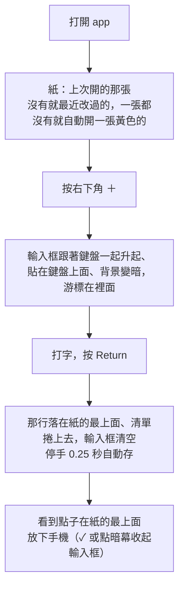
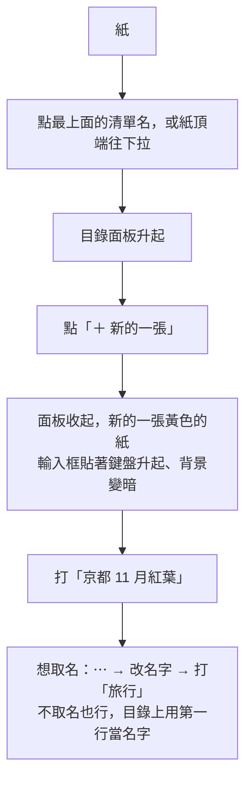
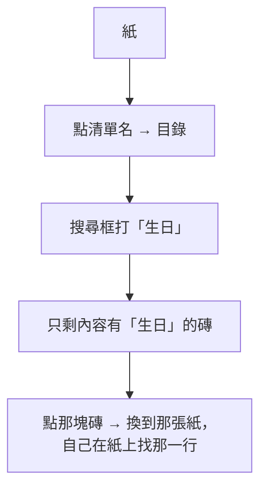
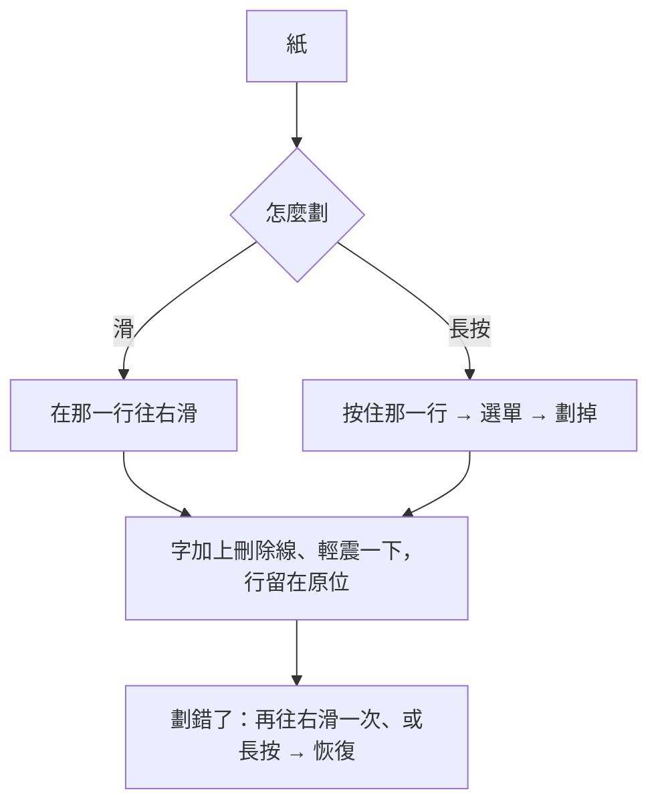
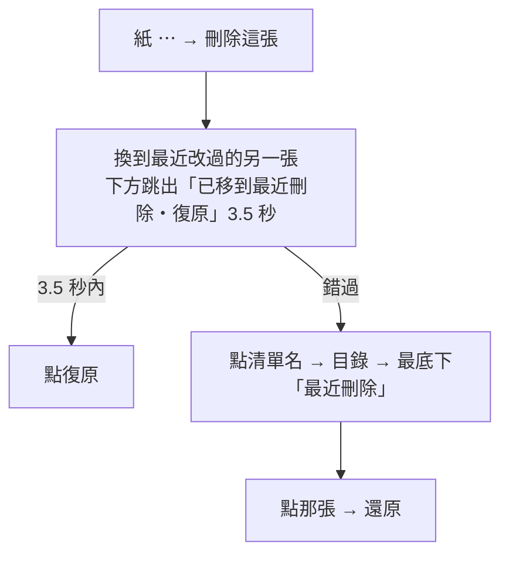
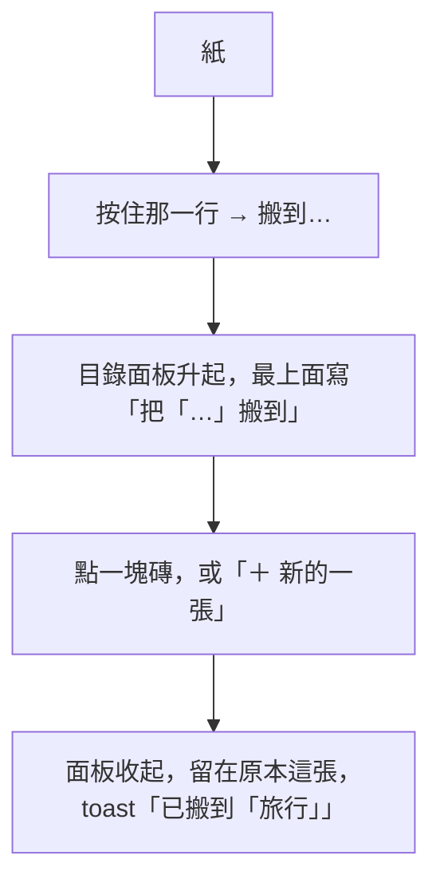
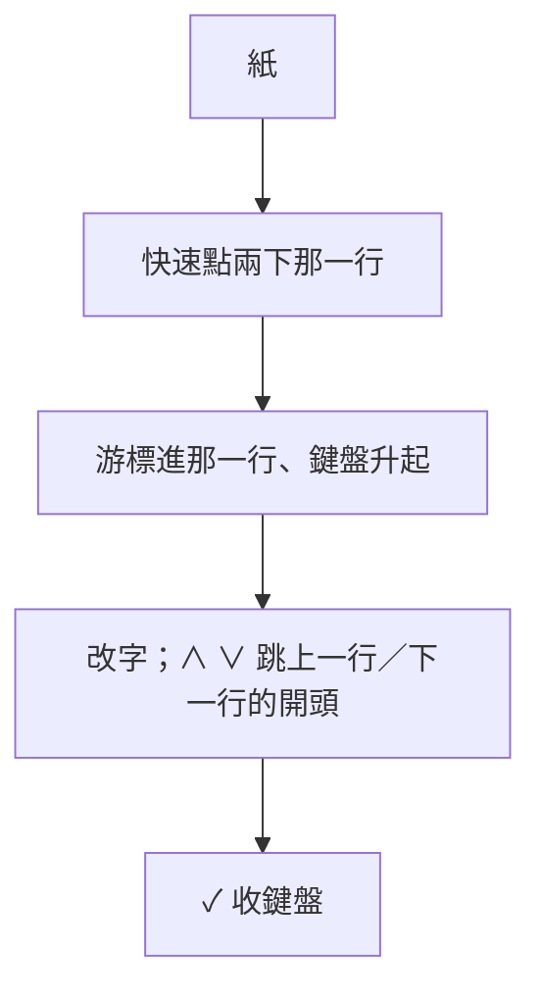

# 茄記｜流程與資訊架構（暫定 v1「紙是家」）

> 狀態：**暫定**。依據 `01-核心動作卡-暫定.md` v0.3（核心動詞＝記，未過閘門 1，情境全為想像）。
> **v1（2026-10-31）**：照 `重新設計/提案.md` 與四輪真機過的程式重寫。v0 是「首頁目錄 → 清單頁」，v1 是「紙是家」：根畫面就是一張紙，目錄降成面板。v0 的 ❓ 定案留在第九節當歷史。
> 只畫使用者怎麼走、要哪些畫面，不畫畫面長相。標 ❓ 的是多米要決定的地方。

---

## 一、核心迴圈（從「成功的感覺」倒著推）

成功的感覺：「把腦子的粗點子排空了……輕鬆了，不用再記在腦裡了」

| 倒推 | 這一格 | 它怎麼幫最後那一刻 | 判斷 |
|---|---|---|---|
| 5 | 放下手機，覺得輕鬆 | 這就是終點 | 保留 |
| 4 | 看到那行在紙的最上面 | 確認真的存下來了，才敢忘掉 | 保留 |
| 3 | 打字 | 點子離開腦袋 | 保留 |
| 2 | 按右下角 ＋，輸入框跟著鍵盤一起升起、貼在鍵盤上面、背景變暗（2026-11-01 多米定；同日第二版曾升到畫面正中，多米看了體感糟，第三版貼回鍵盤；之前是最上面開一空行、游標停在那） | 想法還熱的時候就能寫 | 保留 |
| 1 | 打開 app，就是上次那張紙 | 起點。**不用先選清單**：紙已經攤在那裡 | 保留 |

迴圈：打開 app → 按 ＋ → 打字 → 看到它在最上面 → 放下手機。

v0 的第 2 格「先決定這個點子要放哪張清單」在 v1 消失了：每一行還是屬於某張紙（多米 ❓A 選甲，沒變），只是「選哪張」從「每次記之前」變成「想換的時候才做」（點清單名開目錄）。

---

## 二、任務路徑

每條都寫成一句完整的話，之後直接當樹狀測試的題目。

| # | 任務（測試題） | 頻率 |
|---|---|---|
| T1 | 你剛想到一個點子，想在忘記之前把它記進茄記。 | 最高，核心迴圈 |
| T2 | 你想把跟「旅行」有關的點子另外放在一起。 | 中 |
| T3 | 你記得上週記過一個跟「生日禮物」有關的點子，現在想找出來。 | 中 |
| T4 | 其中一個點子你已經做到了，想把它劃掉。 | 低（「少部分」） |
| T5 | 你剛剛不小心刪掉一整張清單，想把它找回來。 | 低 |
| T6 | 其中一個點子你覺得放錯張了，想把它搬到「旅行」那張。 | 低 |
| T7 | 其中一行你想改幾個字。 | 中 |

### T1 記點子（v1 的走法）



想接著記下一個：Return 送出後輸入框還在、已清空，直接打下一個；✓ 或點暗幕才收起（2026-11-01；同日加暗幕：整個畫面變暗，點外面＝✓，不能再點到別行；第二版曾把框升到正中，第三版貼回鍵盤上面）。打到一半收起、切 app、換紙，框裡的字都會先變成一行，不丟。

### T2 開一張新的



標題從 v0 的「開新清單第一件事」變成選填的最後一件事。

### T3 找舊點子



### T4 劃掉



劃掉的行**留在原位**（多米 2026-10-31：劃掉的還會再看、還會有新想法；真的不要會自己刪）。

### T5 找回刪掉的清單



刪掉的**單行**也走同一條：往左滑或長按 → 刪除 → toast 復原；錯過就在最近刪除頁「刪掉的行」那一段找，還原回原本那張紙的最上面。

### T6 搬到別張



### T7 改一行的字



點一下**不會**進編輯（多米 2026-10-31：上下捲動時常不小心碰到字就跳鍵盤）。

---

## 三、四條岔路

只列，不設計畫面（畫面文案在 `06-首次體驗`）。茄記沒有網路、沒有帳號、沒有權限、沒有購買，「失敗」岔路很少。使用者自己按取消不算錯誤。

| 路徑 | 第一次 | 沒有內容 | 失敗 | 被打斷（來電、鎖屏、切 app、被系統結束） |
|---|---|---|---|---|
| T1 記點子 | 第一次打開就是一張空的黃色紙：標題列下一行時間、扁平線條的茄子＋「這張還是空的／點右下角的 ＋ 記一行」。畫面上只有 ＋ 能按 | 同左 | 存檔失敗（空間不足）→ 系統提示框一顆按鈕，成功存回去前只跳一次（v0 ❓7 定案不變） | 進背景時立刻把打到一半的字存起來；下次打開直接回到這張紙。游標與鍵盤不還原。✅ 多米真機過 |
| T2 開新的一張 | 目錄第一格就是「＋ 新的一張」 | 新的一張開好就有一空行、鍵盤升起；什麼都沒打就換到別張，那張空紙自動消失（不算錯誤） | 同上 | 標題已經打了就留著；什麼都沒打就被結束，下次回到這張空紙 |
| T3 找舊點子 | 目錄搜尋框永遠在最上面 | 搜不到 →「找不到含「{搜尋字}」的清單」；篩選無結果 →「沒有{色名}的清單」 | 無 | 搜尋字不保留，面板收了就重來（低頻，可接受） |
| T4 劃掉 | 紙最底下一行提示「點兩下改字 · 往右滑劃掉 · 往左滑刪除 · 按住有更多」，劃過或刪過一次就永遠消失；長按選單是看得見的第二條路 | 空行滑了不會劃掉（合理） | 無 | 無 |
| T5 找回 | 要知道「最近刪除」在目錄最底下（有東西才出現那一列） | 「最近刪除是空的／刪掉的清單和行會先放在這裡」 | 無 | 無 |
| T6 搬到 | 只在長按選單裡，第一次要靠提示那句「按住有更多」 | 目錄只有這一張時，只能搬進「新的一張」 | 搬的途中那行被別的路徑刪掉：面板當普通目錄用，不搬 | 無 |
| T7 改字 | 提示那句「點兩下改字」 | — | 無 | 同 T1 |
| （周邊）30 天自動清 | 新功能，尚未接 | — | 超過 30 天被清掉的清單找不回來，這是刻意的，但要讓人事先知道 | — |
| （周邊）匯入備份 | 在目錄的 ⋯ 裡 | — | 不是備份檔 →「這不是茄記的備份檔，現有清單沒動」；選檔時取消 → 安靜結束 | — |

---

## 四、進入點

| 進入點 | 現在有嗎 | 落在哪 | 怎麼回主線 |
|---|---|---|---|
| 主畫面圖示 | 有 | 上次開著的那張紙；沒有就最近改過的；一張都沒有就自動開一張 | 已經在主線上 |
| 通知 | 沒有 | — | 不做清單第 4 條：不做推播 |
| 主畫面／鎖定畫面小工具 | 沒有 | — | 多米決定先不做（之後可能長出來） |
| 控制中心、動作按鈕、捷徑 | 沒有 | — | 同上 |
| 從別的 app 分享進來 | 沒有 | — | 同上。之後要做時，先定「從外面進來的行放進哪張紙」：最直覺是「上次那張」 |
| Spotlight 搜尋 | 沒有 | — | 同上 |
| 網址連結 `qieji://` | app.json 有設 scheme，但沒有任何地方用到 | 依路徑 | 目前不對外，先不列 |

> 小工具、控制中心、動作按鈕、捷徑、分享延伸的 iOS 行為是「會過時」項目，書的查證日期 2026-10，實作前要重查。

---

## 五、畫面清單

| 畫面 | 結構 | 唯一主角 | 從哪來 | 回哪去 | 要處理的狀態 |
|---|---|---|---|---|---|
| 紙 | 堆疊的根 | **右下角 ＋ 和一行一行的字**（主角是寫，不是劃掉） | 打開 app、目錄點一塊磚、刪除這張後自動換 | — | 第一次（空、黃）、有內容、被打斷回來、拖曳中（2026-11-01 把手常駐，排順序模式拿掉）、改名字中 |
| 目錄面板 | 系統表單（formSheet，九成高） | 色磚 | 點清單名、紙頂端往下拉、長按 → 搬到… | 點磚或往下拉收回紙 | 第一次（只有一塊磚）、搜尋無結果、篩選無結果、有釘選、搬行模式 |
| 最近刪除 | 堆疊推入（從面板 replace 過去） | 被刪掉的清單與行 | 目錄最底下那列 | 紙 | 空、有清單、有刪掉的行、（新）30 天自動清的說明 |
| 紙的 ⋯ 選單 | 自己畫的彈出卡片 | — | 紙右上 | 原地 | 最上面一排九個色塊；有劃掉的行才出現「全部恢復／清掉劃掉的行」；兩行以上才出現「上下順序反轉」（「排順序」2026-11-01 拿掉：每行右邊常駐把手，拖了就排） |
| 長按選單 | 自己畫的彈出卡片，放在那一行正下方 | — | 按住一行 | 原地 | 空行只剩「刪除」 |
| 目錄的 ⋯ 選單 | 自己畫的彈出卡片（跟紙的 ⋯ 同一張；2026-11-01 多米定 A1 全部自繪，之前是系統動作表單、選篩選還要再升一層） | — | 面板右上 | 原地 | 最上面一排九個真色塊＝篩選（點選中的那顆＝取消）；「全部顏色 ✓」；「排序」四項打勾；匯出／匯入 |
| 最近刪除點一則的選單 | 自己畫的彈出卡片，錨在按下去的位置（2026-11-01 A1；之前是系統動作表單） | — | 點一張或一行 | 原地 | 還原／永久刪除 |
| 系統分享表、檔案選擇器 | 系統畫面 | — | 分享、匯出、匯入 | 原畫面 | 取消 |

一共 3 個自己的畫面（紙、目錄、最近刪除），不需要分頁列。v0 的清單頁與顏色面板退役：清單頁變成根，顏色併進 ⋯ 選單。

---

## 六、路徑長度（看會不會猶豫，不數點擊）

只看高頻的 T1。

| 起點 | 走法 | 會猶豫的地方 |
|---|---|---|
| 冷啟動 | 打開 → 按 ＋ → 打字 | ＋ 在右下角，左手單手要跨過螢幕（單手檢查表第 1 項） |
| 想開新的一張 | 點清單名 → 新的一張 → 打字 | 「點清單名會開目錄」第一次看不出來，靠 ⌄ 小圓和往下拉兩條路 |
| 想接著記第二行 | 在輸入框裡：按 Return 送出、框清空接著打。在行裡改字：按 Return → 正下方長出新的一行 | 不用收鍵盤（❓D 2026-10-31 由 Return 回答，多米真機過）。另一條路：膠囊上的 ＋ 升起輸入框（2026-11-01 改；原本在最上面開一行） |

低頻的 T3～T7：每一步看得出下一步，除了「最近刪除」在目錄最底下（T5，靠復原 toast 補）和「搬到」藏在長按裡（T6，靠提示那句補）。

---

## 七、結構樹與樹狀測試包

### 純文字結構樹（用 app 現在的字）

```
茄記
├─ 紙（打開就是）
│   ├─ ＋（右下角）→ 輸入框貼著鍵盤升起、背景變暗，Return 送出到最上面
│   ├─ 一行：點兩下改字／往右滑劃掉／往左滑刪除／按住 → 劃掉、搬到…、複製、刪除
│   ├─ 清單名 ⌄ → 目錄
│   └─ 選單 ⋯
│       ├─ 九個色塊
│       ├─ 改名字
│       ├─ 釘選
│       ├─ 分享
│       ├─ 複製全文
│       ├─ 上下順序反轉／全部恢復／清掉劃掉的行（排順序改成每行右邊的把手，2026-11-01）
│       └─ 刪除這張
└─ 目錄（面板）
    ├─ 搜尋清單
    ├─ ＋ 新的一張
    ├─ 已釘選／其他 的色磚 → 換到那張紙
    ├─ 選單 ⋯
    │   ├─ 依顏色篩選
    │   ├─ 排序方式
    │   └─ 匯出備份／匯入備份
    └─ 最近刪除（有東西才出現）
        ├─ 點一張 → 還原／永久刪除
        ├─ 刪掉的行：點一行 → 還原到「那張」／永久刪除
        └─ 清空最近刪除
```

> 樹狀測試測不到手勢。T4、T6、T7 在紙上只能測「他會不會往那一行本身找」，找不找得到滑動、長按、點兩下要留到可用性測試。

### 題目

T1～T7，照第二節的句子唸，不要改字。

### 做法（⚪ 一人開發可用）

1. 把上面的樹印出來，每一層剪開，用紙蓋住下一層。
2. 唸一題，請對方用手指點「你會點哪裡」，點了才掀開下一層。
3. 不提示、不解釋，對方問「這是什麼意思」就回「你覺得呢？」
4. 找 **5 個沒用過茄記的人**。你自己和看過你做這個 app 的人不算。

### 記錄表

| 受測者 | 題目 | 第一下點哪 | 完整路徑 | 有沒有退回 | 最後停在哪 | 成功 Y/N | 直接 Y/N | 他說了什麼 |
|---|---|---|---|---|---|---|---|---|
| A | T1 | | | | | | | |

---

## 八、樹狀測試結果

待測。

---

## 九、❓ 決定紀錄

### v1 新的 ❓

**D. 鍵盤開著時要不要能加下一行？** 現在 ＋ 被鍵盤蓋住就不畫，要先 ✓ 收鍵盤再按 ＋。
| 方案 | 怎麼走 | 代價 |
|---|---|---|
| 甲 | 維持：收鍵盤再按 ＋ | 連記兩個點子要多兩下 |
| 乙 | 鍵盤膠囊 ∧ ∨ 旁邊多一顆 ＋ | 膠囊變四顆；但「連續記」是核心迴圈最常接著做的事 |
| 丙 | 在最後一行按換行＝開新的一行 | 跟「換行留在同一格」（v0 實測定下來的）衝突，不推薦 |

待多米。推薦乙。

### v0 的定案（仍有效的留著）

**A. 記點子之前，要不要先決定放哪張清單？** 多米選甲「每個點子都屬於某張清單」。v1 仍然如此，只是打開 app 時已經停在上次那張，不用每次選。

**B. 除了主畫面圖示，還要哪些進入點？** 先都不做。不變。

**C. 首頁用時間分組算不算壓力？** 改成「已釘選／其他」。v1 的目錄面板照用；沒有釘選時不印「其他」。

### 多米在重新設計分支上定的（2026-10-31，真機後）

- 一行要**快速點兩下**才進編輯，一下不會
- **不要底部輸入列**，要右下角 ＋（輸入列超過一行看不到前面）
- **劃掉留在原位**，不下沉
- 鍵盤膠囊左邊要 ∧ ∨（v0 拿掉過，這次明確要回來），跳到下一行的**開頭**、鍵盤不收
- 新的一張預設**黃色**

## 已決定的程式修改

| 來源 | 要改什麼 | 狀態 |
|---|---|---|
| v0 不做清單 #8、❓C、審查 #14 | 時間列、時間分組、新增一行對比 | ✅ 已改（v0 時期）；時間列 2026-10-31 多米又要回來，已放回 |
| ❓D | 鍵盤膠囊多一顆 ＋ | ✅ 2026-10-31 多米選加，已做 |
| 重新設計 | 紙是家、目錄面板、右下 ＋、點兩下、長按、刪行進最近刪除、搬到、排順序、往下拉、劃掉留原位、∧ ∨、預設黃 | ✅ 2026-10-31 四輪真機過，已併回 master |
| 要做 #11 | 最近刪除 30 天後自動清掉（含刪掉的行，`bin` 裡的行已有 `at` 時間） | ⛔ 仍被 VibeRails 守門擋下，待會寫程式的人看過 `.vibe/待審-最近刪除30天自動清.md` |
| ❓D | 鍵盤開著加下一行 | ✅ 2026-10-31 **Return**：打字中按 Return＝在這行正下方開新的一行（游標後面的字一起切過去）；空行按 Return＝收鍵盤。膠囊 ＋ 與右下 ＋ 仍插最上面。多米真機過；2026-11-01 起兩顆 ＋ 都改成升起底部輸入框，送出的行仍插最上面 |
| 多米 2026-11-01 | 右下 ＋ 改成從底下升起的輸入框 | ✅ 2026-11-01 已做（`src/components/Composer.tsx`）：Return 送出一行到最上面、清單捲上去、框清空不收；空的按 Return 收起；✓、點外面、切 app、換紙有字就先送出再收起；新的一張直接停在輸入框。同日第二版（多米提）：整個畫面鋪暗幕（跟動作表單同一組）、點暗幕＝✓，不能再點到別行；框曾升到正中，多米看了體感糟，第三版貼回鍵盤上面、進出跟鍵盤同一個時鐘（審查紀錄 2026-11-01）。**待真機** |
