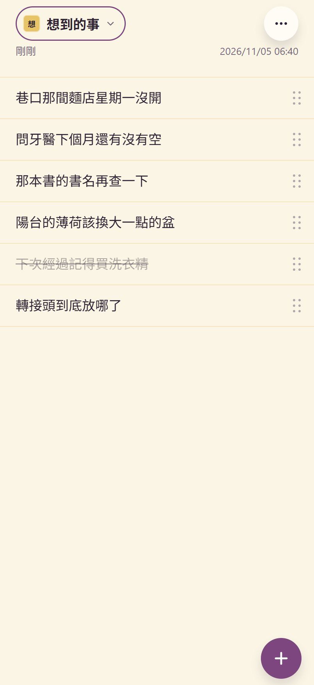
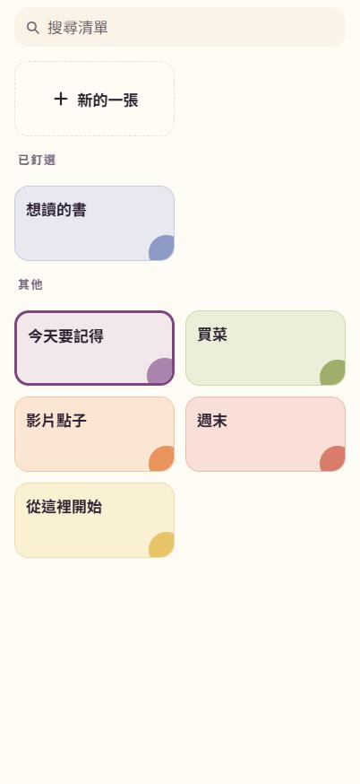
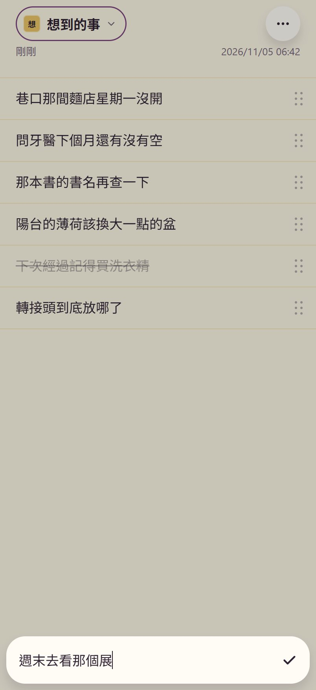
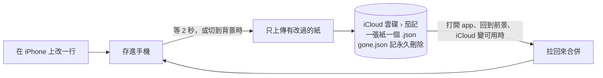

<p align="center">
  
</p>

<h1 align="center">茄記</h1>

<p align="center">一張紙，一行一件事。想到就記，不會催你。</p>

<p align="center">
  
  
  
  
</p>

<p align="center"><sub>左起：一張紙、目錄、按 ＋ 記一行、深色模式。截圖是用網頁預覽拍的，字型跟 iPhone 上略有不同。</sub></p>

---

茄記是一個 iPhone 隨手記 app。想到什麼就記下來，不用再記在腦裡，大部分可能就放著，少部分有做到就劃掉。它沒有到期日，不會跳通知，圖示上不會有紅色數字，也不會幫你算完成了幾成。

打開就停在你上次那張紙上，右下角按 ＋ 就能打字。沒有帳號、不用登入、不要任何權限，紙存在手機裡，再用你自己的 iCloud 雲碟在裝置之間同步。

它的前身是網頁版茄記（[easynote](https://github.com/domyweb666/easynote)），在 Safari 裡用。這個 repo 是改寫成 iOS 原生 app 的版本。

## 能做什麼

### 記
- 打開 app 就是上次那張紙，右下角 ＋ 升起輸入框，按 Return 連續記好幾行
- 點進一行改字時，Return 是換行，一則可以寫好幾段；貼上一整段也留在同一則
- 控制中心可以加一顆「記一行」按鈕（iOS 18 以上），在任何畫面按下去就直接開好輸入框；同一顆也能放到鎖定畫面下方、指定給動作按鈕

### 整理
- 往右滑劃掉，往左滑刪除
- 按住右邊的小點點上下拖，換順序
- 點一行改字，按住一行看更多動作
- 九種顏色的紙，用蔬菜命名：茄子、玉米、紅蘿蔔、甜椒、藍莓、青蔥、香菇、黑豆、白蘿蔔
- 點左上的清單名打開切換清單：釘選的（最多 5 張）、這台最近開過的，最上面可以開新的一張
- 切換清單最下面的「管理所有清單」打開目錄：方磚的排法跟手機主畫面一樣，可以自由擺放、疊成資料夾、放不下往右翻頁
- 目錄的搜尋會列出符合的每一行，點一下捲到那一行

### 找回來
- 刪掉的紙和行都先進「最近刪除」，30 天內可以還原
- 第一次打開會有一張「從這裡開始」的教學紙，六行教你所有手勢

### 在 app 外面
- 主畫面與鎖定畫面小工具：顯示上次那張紙的名字和前幾行，點了打開 app
- iCloud 雲碟同步：每張紙是「檔案 › iCloud 雲碟 › 茄記」裡的一個 `.json`，換手機或刪掉重裝，紙會自己回來

### 看起來
- 跟著系統切淺色、深色
- 支援系統字級放大、減少動態
- 所有顏色在淺色、深色模式下都算過對比

## iCloud 同步怎麼運作



幾條規則：

- 每張紙有一個內容指紋，只有指紋變了才上傳
- 上傳前先讀 iCloud 上那份，如果別台裝置已經改過，就先拉回來合併，不直接蓋掉
- 兩台各自改同一張紙，合併時兩邊新增的行都留著
- 永久刪除的紙記在 `gone.json`，另一台還留著那張，也不會再同步回來
- 沒網路、iCloud 雲碟沒開時照常能用，恢復之後補傳；雲碟沒開會提示一次
- 換了 Apple ID 或 iCloud 裡的資料夾被刪掉，會停下來問你要不要把紙放進去，不會悄悄混在一起

## 技術

| 項目 | 用的東西 |
|---|---|
| 框架 | Expo SDK 58、React Native 0.88（新架構）、TypeScript |
| 路由 | Expo Router |
| 手勢與動畫 | react-native-gesture-handler、react-native-reanimated、react-native-worklets |
| 鍵盤 | react-native-keyboard-controller |
| 本機儲存 | AsyncStorage（整份資料一個 JSON） |
| iCloud 雲碟 | react-native-cloud-storage |
| 小工具 | expo-widgets（`@expo/ui` 的 SwiftUI 元件） |
| 控制中心按鈕 | @bacons/apple-targets（Swift，`ControlWidgetButton`） |
| 建置 | EAS Build（不需要 Mac） |

## 專案結構

```
src/
  app/               畫面（Expo Router，每個檔案一個畫面）
    index.tsx          一張紙（app 的根）
    trash.tsx          最近刪除
    +native-intent.tsx 接 qieji://new（控制中心按鈕）
  components/        Paper、Composer、DirPanel（目錄）、SwitchPanel（切換清單）、PopMenu 等元件
  lib/
    model.ts           資料格式、排序、最近刪除、同步合併規則
    rows.ts            紙上每一行站哪裡的位置表（清單引擎用）
    store.ts           讀寫本機、什麼時候上傳與拉取
    cloud.ts           iCloud 雲碟讀寫（每個呼叫都有逾時）
    widget.ts          算好小工具要顯示的內容推過去
    tokens.ts          顏色、字級、間距等設計代號（唯一來源）
widgets/             桌面與鎖定畫面小工具
targets/controls/    控制中心「記一行」按鈕（Swift）
plugins/             設定 iCloud 資料夾名稱的 config plugin
patches/             @bacons/apple-targets 的修補（patch-package）
tests/               資料規則與兩台裝置同步模擬的測試
tools/               裸數字檢查、pre-commit hook
```

## 開發

需要 Node 24 和一台裝了開發版茄記的 iPhone。本機是 Windows 也可以，原生部分全部交給 EAS 在雲端建置。

```bash
npm install
```

改 JavaScript，用 tunnel 讓手機連進來重載：

```bash
npx expo start --tunnel
```

改到原生的東西（圖示、小工具、控制中心、加了有原生程式的套件），要重新建置開發版：

```bash
npx eas-cli@latest build --profile development --platform ios
```

送出前跑一次檢查：

```bash
npm test            # 資料規則，含兩台裝置同步模擬
npm run typecheck
npm run lint
npm run check:tokens   # 畫面檔裡不准有寫死的顏色、字級、間距
```

`npm install` 會把 git hook 指到 `tools/githooks`，commit 時自動跑裸數字檢查。

## 隱私

茄記不蒐集任何資料。沒有伺服器、沒有分析工具、沒有廣告，也不要任何系統權限。紙只存在你的手機和你自己的 iCloud 雲碟裡。

## 作者

陳多米（[domyweb666](https://github.com/domyweb666)）
