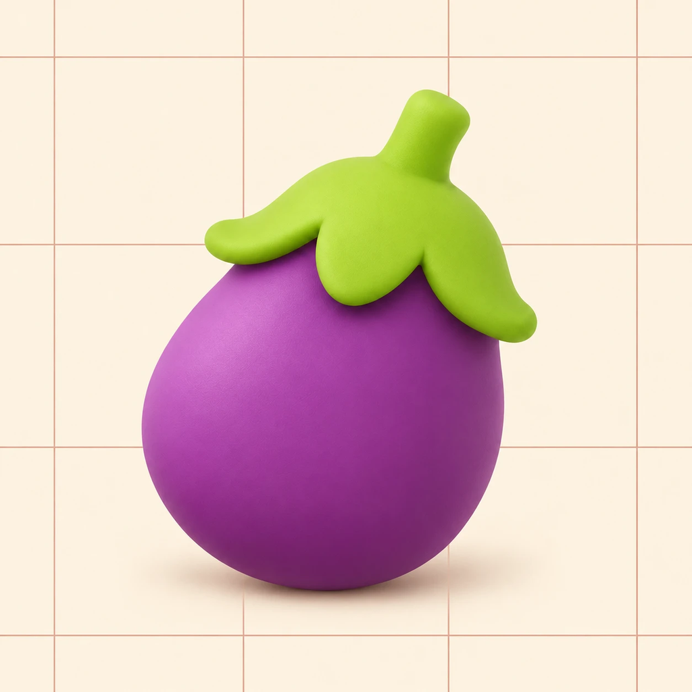
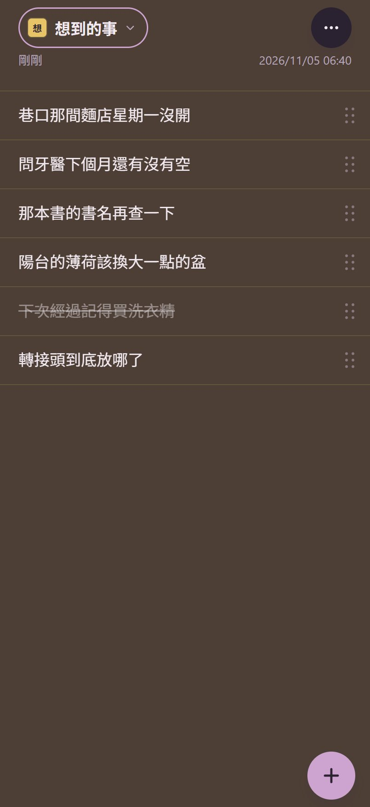
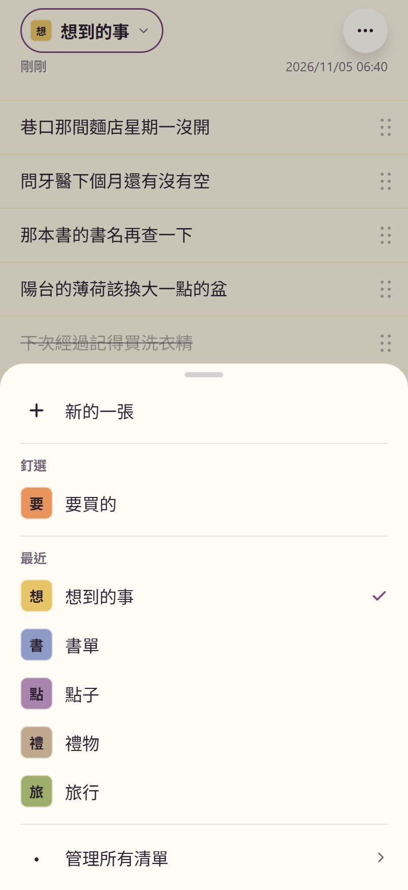
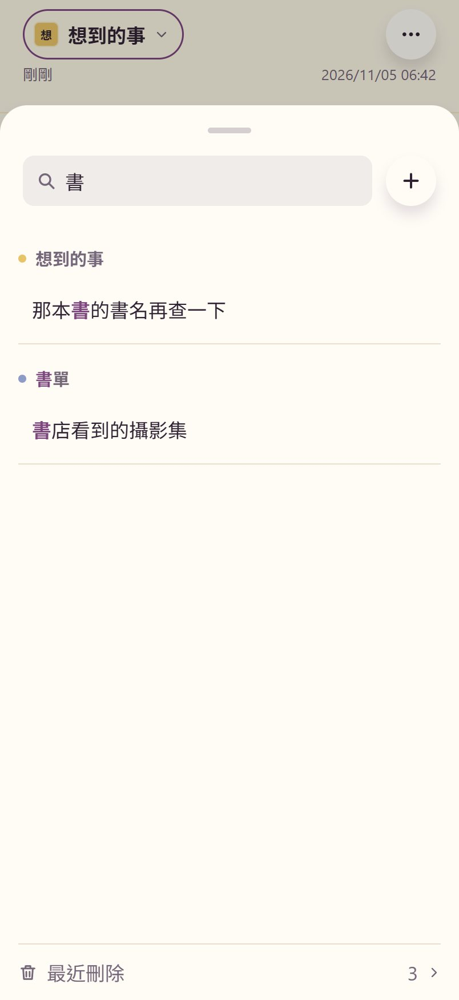
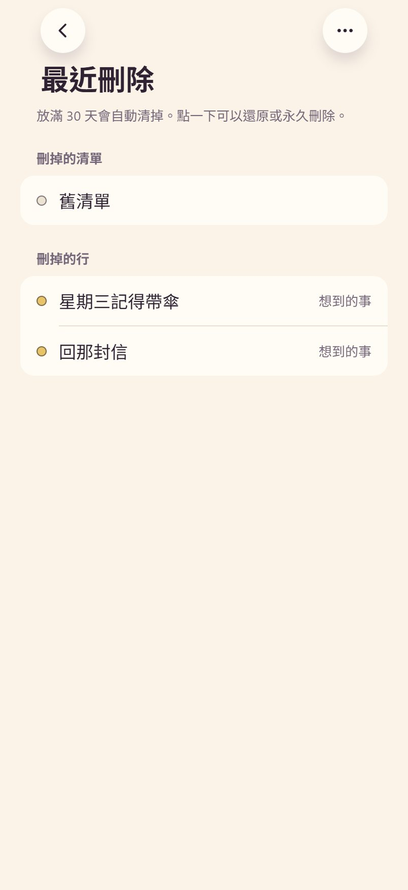
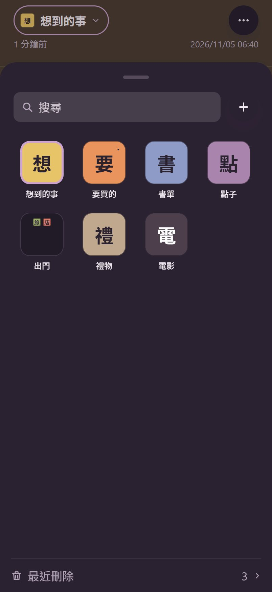
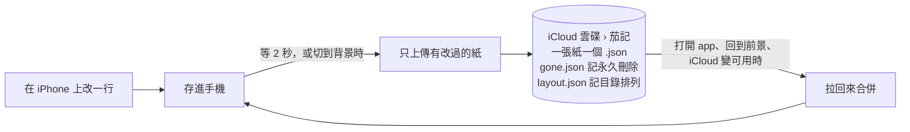

<p align="center">
  
</p>

<h1 align="center">茄記</h1>

<p align="center">一張紙，一行一件事。想到就記，不會催你。</p>

<p align="center">
  
  
  
  
</p>

<p align="center"><sub>左起：一張紙、按 ＋ 記一行、目錄、深色模式。</sub></p>

---

茄記是一個 iPhone 隨手記 app。想到什麼就記下來，不用再記在腦裡，大部分可能就放著，少部分有做到就劃掉。它沒有到期日，不會跳通知，圖示上不會有紅色數字，也不會幫你算完成了幾成。

打開就停在你上次那張紙上，右下角按 ＋ 就能打字。沒有帳號、不用登入，紙存在手機裡。

記、劃掉、整理、搜尋都免費，沒有廣告。1.1 起多一個一次買斷的「茄記完整版」，買了才有 iCloud 同步、小工具、控制中心的「記一行」、封面圖、個別上鎖、記事本和紙上的字級，細節在下面[茄記完整版](#茄記完整版)。

它的前身是網頁版茄記（[easynote](https://github.com/domyweb666/easynote)），在 Safari 裡用。這個 repo 是改寫成 iOS 原生 app 的版本。

> 這份的圖是用網頁預覽和示範內容拍的，字型跟 iPhone 上略有不同。iPhone 上的 ⋯ 是系統選單，按鈕是液態玻璃，網頁預覽畫不出來。

## 怎麼用

### 記一行

<p align="center"></p>

按右下角 ＋，輸入框貼著鍵盤升起，後面的紙變暗。打字按換行鍵，那行就出現在紙的最上面，框清空，鍵盤不收，可以接著記下一行。

從別的地方貼好幾行進來，框的左上方會冒一顆「拆成 N 行」，按了就一行一行分開記；不按，就整段記成一則。拆完可以按「復原」變回來。

打到一半被打斷也不會丟字：按框右邊的 ✓、點紙上的空白處、點別行，字都會先記下來。回主畫面後把 app 從多工畫面滑掉，再打開，剛打的字也還在。

### 整理一行

<p align="center"></p>

| 手勢 | 會怎樣 |
|---|---|
| 往右滑 | 劃掉，字變淡、加刪除線，留在原位；再滑一次恢復 |
| 往左滑 | 刪掉，下面跳「復原」，也可以到最近刪除找 |
| 點一下 | 游標落在你點的地方，原地改字 |
| 按住 | 選單：劃掉、搬到別張、複製、刪除，最下面寫著這行是什麼時候記的 |
| 拖右邊六個小點 | 換順序，拖到上下緣紙會自己捲 |

在行裡按換行鍵是同一則分段，貼上一整段也留在同一則。游標在行首按刪除鍵，會併回上一行。

右上角 ⋯ 可以換紙的顏色、改名字、釘選、分享、複製全文、清掉劃掉的行、刪除這張。

### 換一張紙

<p align="center"></p>

點左上的清單名，切換清單從下面升起：最上面開新的一張，下面是釘選的（最多 5 張）和這台最近開過的（最多 5 張），正在看的那張打勾。

九種顏色用蔬菜命名：茄子、玉米、紅蘿蔔、甜椒、藍莓、青蔥、香菇、黑豆、白蘿蔔。

### 目錄

<p align="center"></p>

切換清單最下面的「管理所有清單」打開目錄。排法跟手機主畫面一樣，一排四塊方磚，紙的顏色加中間一個字，那個字預設是名字的第一個字，可以換成別的字或 emoji。

- 按住一張：磚浮起，選單有一排顏色、改磚上的字、釘選、刪除
- 按住後接著拖，或按住空白處：全部抖動，可以拖磚排位置
- 拖到別張上繼續往前推：互換；蓋上去放手：疊成資料夾
- 拖到左右邊緣停一下：翻頁，最後一頁再往右會開新的一頁
- 位置可以空著，別張不會自己往前補

資料夾一頁 3 × 3，可以改名、在裡面排順序，也可以把紙拖出來放回目錄。

### 搜尋

<p align="center"></p>

目錄上面的搜尋框會直接列出符合的每一行，打中的字標成茄紫色。點一行就換到那張、捲到那一行亮一下；點清單名那一列就打開那張。

### 最近刪除

<p align="center"></p>

刪掉的紙和行都先放在這裡 30 天，滿 30 天自動清掉。目錄最下面進得來。還原一行會回到那張紙最上面；還原一張紙，原本那格還空著就回那格。

### 第一次打開

會有一張「從這裡開始」的紙，七行字教你手勢和怎麼換紙，照著做一遍就會用了。

### 在 app 外面

這兩樣免費：

- 從別的 app 分享進來：在 Safari 或其他 app 選一段字、一個網址，按分享、選茄記，字就在面板上，可以改、可以選放進哪張，按 ✓ 記下。下次打開茄記，它在那張紙的最上面。圖片和檔案不收
- 長按主畫面的圖示，選「記一行」：直接打開茄記並開好輸入框

下面兩樣是完整版功能。沒買的時候它們照樣會出現在系統的清單裡（Apple 不讓 app 依買了沒把它們藏起來），加上去會顯示鎖住，點了打開茄記的付費頁。

- 控制中心的「記一行」（iOS 18 以上）：在任何畫面按下去，直接打開茄記並開好輸入框。同一顆也能放到鎖定畫面下方，或指定給動作按鈕
- 主畫面小工具（小、中、大）和鎖定畫面小工具：顯示上次那張紙的名字和前幾行，點了打開 app

### 深色模式與輔助使用

<p align="center">
  
  
</p>

跟著系統切淺色、深色，所有顏色在淺色、深色模式下都算過對比。也支援系統字級放大、減少動態、減少透明度和 VoiceOver：VoiceOver 開著時，拖來拖去的動作都有對應的選項，例如「往上移」「往下移」「移出資料夾」。

### 上限

| 項目 | 上限 |
|---|---|
| 一張紙 | 1000 行 |
| 釘選 | 5 張 |
| 最近刪除 | 放 30 天 |
| 裝置 | 只有 iPhone，沒有 iPad 版 |

## 茄記完整版

一次付清，台灣是 NT$390，其他國家照 App Store 換算，不是訂閱。買了之後這個 Apple 帳號的每一台 iPhone 都能用，同一個家庭群組的人也不用再買。

| | 免費 | 完整版 |
|---|---|---|
| 記一行、劃掉、刪除、最近刪除 | ✓ | ✓ |
| 九種顏色、釘選、目錄、資料夾、搜尋 | ✓ | ✓ |
| 從別的 app 分享進來、長按圖示「記一行」 | ✓ | ✓ |
| iCloud 同步 | | ✓ |
| 主畫面和鎖定畫面小工具 | | ✓ |
| 控制中心「記一行」 | | ✓ |
| 封面圖：紙的頂部放一張圖，目錄的磚也換成它 | | ✓ |
| 個別上鎖：打開要 Face ID | | ✓ |
| 記事本：不分行的一整頁 | | ✓ |
| 紙上的字級：小、標準、大、特大 | | ✓ |
| 之後新增的完整版功能 | | ✓ |

買和恢復購買都在「目錄 › 設定」。換手機或重裝之後按一次「恢復購買」就回來了。

沒買的話，紙只存在那一台手機。換手機要靠 iPhone 的整機備份，刪掉茄記再重裝，紙就沒有了。

1.0 的時候 iCloud 同步是免費的。更新到 1.1 之後同步會停下來，手機上的紙和 iCloud 雲碟裡的檔案都不會被動到，買了完整版會接著同步。

付款由 Apple 處理，茄記只知道這個 Apple 帳號買了沒，拿不到付款資料。退款之後完整版功能會鎖回去，紙一樣都還在：放好的封面圖、調好的字級、寫好的記事本都留著，上鎖的清單照樣用 Face ID 打得開，只是不能再新增。

上鎖是在茄記裡擋著不給看，不是加密。上鎖的清單只存在那一支手機，不會同步到 iCloud，換手機之前要先解除上鎖。

## iCloud 同步怎麼運作

iCloud 同步是完整版功能，下面講的是買了、同步開著時的情形。也可以在設定裡自己關掉。



幾條規則：

- 每張紙有一個內容指紋，只有指紋變了才上傳
- 上傳前先讀 iCloud 上那份，如果別台裝置已經改過，就先拉回來合併，不直接蓋掉
- 兩台各自改同一張紙，合併時兩邊新增的行都留著
- 永久刪除的紙記在 `gone.json`，另一台還留著那張，也不會再同步回來
- 目錄排列整份以最後改的那台為準，對不上的紙補在最後
- 沒網路、iCloud 雲碟沒開時照常能用，恢復之後補傳；雲碟沒開會提示一次
- 換了 Apple ID 或 iCloud 裡的資料夾被刪掉，會停下來問你要不要把紙放進去，不會悄悄混在一起

換手機或刪掉重裝時，只要買了完整版、iCloud 雲碟開著、登入同一個 Apple 帳號，按一次「恢復購買」，紙會自己回來。

## 隱私

茄記不蒐集任何資料。沒有伺服器、沒有分析工具、沒有廣告，除了 iCloud 同步和跟 App Store 確認購買之外不連網路，也不跟你要相簿、相機、定位這些權限。只有你把清單上鎖時會用到 Face ID，由 iPhone 自己驗，茄記拿不到你的臉部資料。放封面圖用的是系統的選照片畫面，茄記只拿得到你選的那一張。紙只存在你的手機和你自己的 iCloud 雲碟裡。購買由 Apple 處理，茄記拿不到你的付款資料。

## 技術

| 項目 | 用的東西 |
|---|---|
| 框架 | Expo SDK 58、React Native 0.88（新架構）、TypeScript |
| 路由 | Expo Router |
| 手勢與動畫 | react-native-gesture-handler、react-native-reanimated、react-native-worklets |
| 鍵盤 | react-native-keyboard-controller |
| 系統選單 | `@expo/ui` 的 SwiftUI 元件 |
| 本機儲存 | AsyncStorage（整份資料一個 JSON） |
| iCloud 雲碟 | react-native-cloud-storage |
| 小工具 | expo-widgets |
| 控制中心按鈕 | @bacons/apple-targets（Swift，`ControlWidgetButton`） |
| 建置 | EAS Build（不需要 Mac） |

## 專案結構

```
src/
  app/               畫面（Expo Router，每個檔案一個畫面）
    index.tsx          一張紙（app 的根）
    trash.tsx          最近刪除
    settings.tsx       設定：茄記完整版、iCloud 同步開關、關於
    full.tsx           茄記完整版的付費頁（半高表單）
    +native-intent.tsx 接 qieji://new（控制中心按鈕）、qieji://full（鎖住的小工具）
  components/        Paper、Composer、DirPanel（目錄）、SwitchPanel（切換清單）、NativeMenu（系統選單）、PopMenu 等元件
  lib/
    model.ts           資料格式、目錄座位表、最近刪除、同步合併規則
    rows.ts            紙上每一行站哪裡的位置表（清單引擎用）
    store.ts           讀寫本機、什麼時候上傳與拉取
    cloud.ts           iCloud 雲碟讀寫（每個呼叫都有逾時）
    widget.ts          算好小工具要顯示的內容推過去
    full.ts            「買了沒」的判斷規則（只信 Apple 驗過的交易）
    iap.ts             接 App Store：讀價格、買、恢復購買
    access.ts          照「買了沒」開關 iCloud 同步和小工具
    review.ts          評分提示的條件
    tokens.ts          顏色、字級、間距、手勢和動畫參數（唯一來源）
    perf.ts            開發版的卡頓記錄，正式版不跑
widgets/             桌面與鎖定畫面小工具
targets/controls/    控制中心「記一行」按鈕（Swift）
plugins/             設定 iCloud 資料夾名稱的 config plugin
patches/             @bacons/apple-targets 的修補（patch-package）
tests/               資料規則與兩台裝置同步模擬的測試
tools/               裸數字檢查、pre-commit hook
```

## 開發

需要 Node 24 和一台裝了開發版茄記的 iPhone。本機是 Windows 也可以，原生部分全部交給 EAS 在雲端建置。

```bash
npm install
```

改 JavaScript，用 tunnel 讓手機連進來重載：

```bash
npx expo start --tunnel
```

只想看資料和版面，可以開網頁預覽。手勢、鍵盤、系統選單以真機為準：

```bash
npx expo start --web
```

改到原生的東西（圖示、小工具、控制中心、加了有原生程式的套件），要重新建置開發版：

```bash
npx eas-cli@latest build --profile development --platform ios
```

正式版建置後自動上傳到 App Store Connect：

```bash
npx eas-cli@latest build --profile production --platform ios --auto-submit
```

每次建置前先跑 `npx expo-doctor`，版本不符就用 `npx expo install --fix` 對齊。原生層照 `node_modules` 編，版本對不上建出來可能一開就閃退；對齊也可能改到畫面，正式版裝上去要看過一遍。

送出前跑一次檢查：

```bash
npm test            # 資料規則，含兩台裝置同步模擬
npm run typecheck
npm run lint
npm run check:tokens   # 畫面檔裡不准有寫死的顏色、字級、間距
```

`npm install` 會把 git hook 指到 `tools/githooks`，commit 時自動跑裸數字檢查。

## 作者

陳多米（[domyweb666](https://github.com/domyweb666)）
